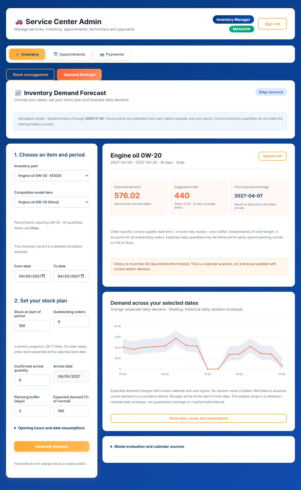

# Smart Vehicle Center — Inventory Demand Prediction

Inventory demand forecasting integrated into the existing service-center dashboard, with matching navigation, styling and stock management.

## Run locally on Windows

1. Install Node.js 22 or newer and Python 3.12 with the `py` launcher.
2. Clone this repository, then run `Setup-System.cmd`.
3. Run `Start-System.cmd` and open http://127.0.0.1:5180/.
4. Sign in with the local demo manager: `manager@servicecenter.dev` / `Manager123!`.
5. Open **Inventory → Demand forecast**, choose the item and dates, then generate a forecast.

The first start downloads the required MongoDB binary from its official distribution. This local mode uses an isolated persistent database; it does not connect to the original cloud database. Use `Status-System.cmd` and `Stop-System.cmd` to check or stop the services.

See [RUN_LOCAL.md](RUN_LOCAL.md) for full installation, configuration, date assumptions, evaluation, retraining and troubleshooting instructions.

## Forecast controls

- Select an inclusive future date range of up to 366 days, including dates beyond the history cutoff.
- Set starting stock, outstanding orders, a confirmed arrival, buffer days and demand percentage.
- Customise weekly opening hours, holiday hours and individual date assumptions.
- View daily expected demand, historical variation envelopes, projected shortages and pack-rounded reorder suggestions.
- Inspect daily assumptions and export CSV. Changed inputs mark previous results stale.

Each date is predicted directly from its calendar features. The system adds no random noise and does not recursively generate demand for intervening dates. Forecasts do not alter stock or place orders.

## Included files

| Folder / file | Purpose |
| --- | --- |
| `admin-web/` | Integrated React/Vite dashboard |
| `backend/` | Express API, inventory mapping and isolated local MongoDB launcher |
| `inventory-ml/service.py` | Daily forecast API |
| `inventory-ml/artifacts/` | Saved model, evaluation and per-item metrics |
| `inventory-ml/data/` | Simulated daily history, SKU catalogue and holiday calendars |
| `inventory-ml/Inventory_Daily_Training.ipynb` | Colab training and evaluation notebook |
| `mobile-app/` | Existing mobile source; not started by the local dashboard launcher |
| [VERIFICATION.md](VERIFICATION.md) | Checks performed locally |

For the Colab notebook, use the GitHub source ZIP or run `python package-local.py` to create a portable source/model ZIP. The notebook has been validated but has not been executed in Google Colab; its training scripts were run locally.

## Data and accuracy

**The operational history is synthetic, not measured Sri Lankan station demand.** The model was trained on 14,000 simulated daily observations for 20 items, using chronological training, validation and locked testing.

Selected model: Ridge seasonal. Locked-test daily macro WAPE: **90.83%**; weekly macro WAPE: **36.71%**. The weekday baseline has weekly WAPE **35.88%**, so this model does not establish improved weekly accuracy. Infrequently used parts have particularly high daily error. WAPE measures error, not accuracy.

The shaded daily envelope is based on validation residuals and is not a guaranteed confidence interval. Actual station demand history, correct units and retraining are required before relying on operational purchasing recommendations.

